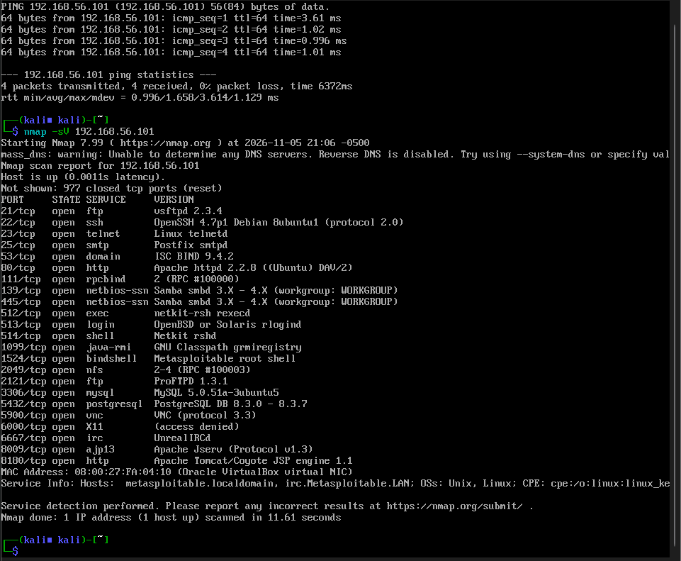
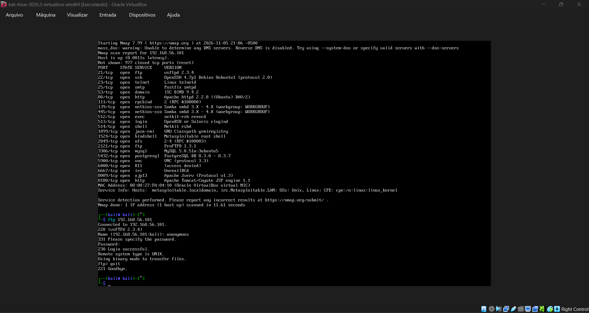
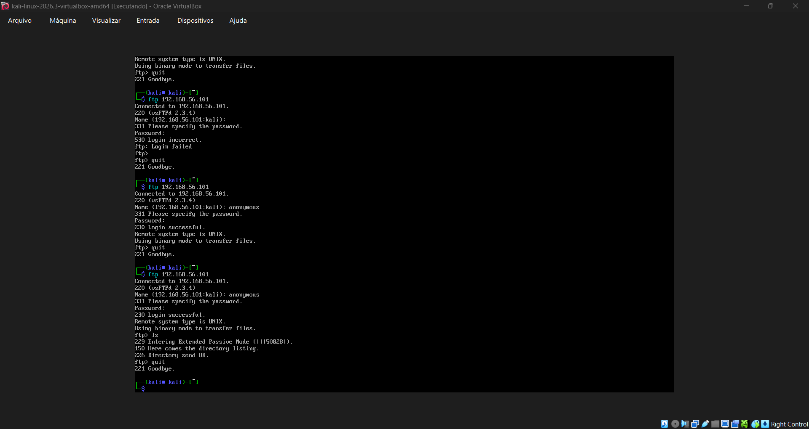

# Auditoria de autenticação em laboratório com Kali Linux, Nmap e Medusa

 

> **Projeto de conclusão — Santander | Cibersegurança do Zero à Prática (DIO)**
>
> **Escopo:** laboratório educacional e autorizado. As simulações não devem ser direcionadas a sistemas de terceiros.

## Visão geral

Este repositório documenta a construção de um laboratório de cibersegurança utilizando **VirtualBox**, **Kali Linux** e **Metasploitable 2**, o reconhecimento de serviços com **Nmap**, a inspeção de um serviço **FTP** e o estudo de testes de autenticação com **Medusa**. Também discute dois outros cenários propostos no desafio: formulários web (**DVWA**) e autenticação **SMB**.

O desafio permite adaptar os cenários e entregar documentação técnica, estudos e reflexões. Assim, este projeto distingue explicitamente os **testes realmente executados** dos **exemplos didáticos não executados**.

## Objetivos

- Preparar máquinas virtuais em rede privada Host-only.
- Validar conectividade e mapear serviços de uma máquina deliberadamente vulnerável.
- Identificar o risco associado ao acesso anônimo por FTP.
- Compreender a lógica de auditorias de senhas com Medusa, incluindo força bruta e password spraying.
- Propor controles de prevenção e apresentar evidências reproduzíveis.

## Arquitetura do laboratório

```text
Windows (host com VirtualBox)
           |
    Rede Host-only
           |
    +------+-----------------+
    |                        |
Kali Linux              Metasploitable 2
192.168.56.102          192.168.56.101
Ferramentas de teste    Alvo intencionalmente vulnerável
```

As máquinas foram configuradas em uma rede Host-only para evitar a exposição do alvo à rede externa. **Não se deve utilizar modo Bridge para o Metasploitable.**

## Ferramentas

| Ferramenta | Papel no projeto |
| --- | --- |
| VirtualBox | Virtualização das duas máquinas |
| Kali Linux | Máquina de auditoria |
| Metasploitable 2 | Alvo de laboratório |
| Nmap 7.99 | Descoberta e identificação de serviços |
| Cliente FTP | Validação de autenticação anônima e listagem |
| Medusa 2.3 | Ferramenta instalada; uso abordado em estudo documentado |
| DVWA | Cenário web estudado conceitualmente; não instalado/testado neste projeto |

## O que foi executado

| Etapa | Comprovação | Status |
| --- | --- | --- |
| Criar e iniciar as duas VMs | Configuração relatada e terminal do Kali | ✅ Realizado |
| Configurar rede Host-only | Comunicação entre 192.168.56.102 e 192.168.56.101 | ✅ Realizado |
| Testar ping | 4 enviados, 4 recebidos, 0% de perda | ✅ Realizado |
| Identificar serviços com Nmap | Nmap 7.99, `-sV`, host ativo, 23 portas TCP abertas | ✅ Realizado |
| Autenticar no FTP | `230 Login successful` com `anonymous` e senha em branco | ✅ Realizado |
| Listar diretório FTP | `226 Directory send OK` sem entradas exibidas | ✅ Realizado |
| Verificar disponibilidade do Medusa | Versão 2.3 informada após verificação | ✅ Realizado |
| Força bruta com Medusa | Exemplo de laboratório explicado, sem execução | 📚 Estudo |
| Login web no DVWA | Fluxo conceitual e mitigação | 📚 Estudo |
| Password spraying SMB | Fluxo conceitual e mitigação | 📚 Estudo |

## Evidências do laboratório

**Reconhecimento de serviços:**



**Autenticação anônima no FTP:**



**Comando `ls` no FTP:**



As imagens são capturas reais da sessão. Não representam uma execução de ataque com Medusa.

## Comandos efetivamente utilizados

```bash
ping -c 4 192.168.56.101
nmap -sV 192.168.56.101
ftp 192.168.56.101
# No cliente FTP:
# usuário: anonymous
# senha: pressionar Enter
ls
quit
```

### Principais achados

O Nmap identificou **23 portas TCP abertas** entre as 1.000 portas padrão pesquisadas. Exemplos:

| Porta | Serviço | Identificação reportada |
| --- | --- | --- |
| 21/tcp | FTP | vsftpd 2.3.4 |
| 22/tcp | SSH | OpenSSH 4.7p1 |
| 23/tcp | Telnet | Linux telnetd |
| 80/tcp | HTTP | Apache httpd 2.2.8 |
| 139 e 445/tcp | SMB | Samba smbd 3.X–4.X |
| 2121/tcp | FTP | ProFTPD 1.3.1 |
| 3306/tcp | MySQL | MySQL 5.0.51a |
| 5432/tcp | PostgreSQL | PostgreSQL 8.3.x |
| 8180/tcp | HTTP | Apache Tomcat/Coyote JSP engine 1.1 |

A resposta **`230 Login successful`** confirmou que o serviço FTP aceita o usuário `anonymous` sem senha informada. O comando `ls` foi concluído, mas não exibiu arquivos ou diretórios. Isso **não** comprova acesso a arquivos confidenciais, permissão de escrita ou comprometimento do host.

## Estudo: três cenários de autenticação

### 1. FTP — auditoria de senhas com Medusa

O Medusa automatiza tentativas de autenticação em serviços suportados. A existência de um serviço FTP aberto, por si só, não prova senha fraca. O exemplo controlado de teste, sem execução neste projeto, está em [scripts/exemplos-laboratorio.sh](scripts/exemplos-laboratorio.sh), com listas didáticas em [wordlists](wordlists/).

### 2. Web — DVWA

Formulários de login podem sofrer tentativas repetitivas de credenciais. O DVWA serve para demonstrar esses fluxos em um ambiente local intencionalmente vulnerável. **Não foi instalado nem testado aqui.** O estudo aborda controles de taxa, MFA, mensagens de erro e monitoração em [docs/cenarios-e-mitigacoes.md](docs/cenarios-e-mitigacoes.md).

### 3. SMB — password spraying

*Password spraying* é o teste de uma senha comum contra várias contas, em contraste com muitas senhas contra uma só conta. O cenário SMB é descrito teoricamente; **não houve enumeração de usuários ou tentativas SMB nesta execução**. Veja [docs/cenarios-e-mitigacoes.md](docs/cenarios-e-mitigacoes.md).

## Recomendações de segurança

1. Desabilitar FTP anônimo quando não for necessário e preferir **SFTP/SSH** para transferência autenticada.
2. Implementar políticas de senha forte e impedir senhas reutilizadas ou conhecidas.
3. Aplicar limites de tentativas, atrasos progressivos, bloqueios proporcionais e alertas.
4. Habilitar MFA onde disponível, especialmente para portais web e contas sensíveis.
5. Monitorar logs de autenticação para detectar padrões de força bruta e spraying.
6. Manter sistemas corrigidos e reduzir serviços expostos ao mínimo necessário.
7. Isolar ambientes vulneráveis, como o Metasploitable, das redes de produção.

Mais detalhes: [docs/cenarios-e-mitigacoes.md](docs/cenarios-e-mitigacoes.md).

## Organização do repositório

```text
projeto-ciberseguranca-medusa/
├── README.md
├── docs/
│   ├── configuracao-ambiente.md
│   ├── testes-realizados.md
│   └── cenarios-e-mitigacoes.md
├── images/
│   ├── 01-nmap-servicos.png
│   ├── 02-ftp-login-anonimo.png
│   └── 03-ftp-listagem.png
├── scripts/
│   └── exemplos-laboratorio.sh
└── wordlists/
    ├── usuarios-exemplo.txt
    └── senhas-exemplo.txt
```

## Aprendizados

A experiência mostrou a importância de separar **serviço exposto**, **configuração insegura** e **exploração comprovada**. Um scan de portas permite levantar hipóteses de risco, mas elas precisam ser validadas. No FTP, comprovou-se apenas o acesso anônimo e a possibilidade de solicitar a listagem. Medusa foi identificado no ambiente, e os demais cenários foram consolidados como estudo para exercitar conceitos de autenticação e defesa.

## Referências

- [Site oficial do Kali Linux](https://www.kali.org/)
- [Manual do Nmap](https://nmap.org/book/)
- [Medusa](http://www.foofus.net/jmk/medusa/medusa.html)
- [DVWA](https://github.com/digininja/DVWA)
- [Documentação do GitHub](https://docs.github.com/pt)

## Nota ética

Este material tem finalidade exclusivamente educacional. Exemplos de auditoria devem ser executados apenas com autorização explícita e escopo limitado. Metasploitable e DVWA são intencionalmente vulneráveis: não devem ser expostos à internet.
